# 基于java的个性化图书推荐系统1k4p4

> 🎓 **计算机毕业设计 · 基于java的个性化图书推荐系统1k4p4**
>
> 本仓库只放**项目介绍 + 运行截图**（截图是站点带水印的原图，存在仓库 `images/` 里）。
>
> 👉 **完整可运行源码 / 数据库脚本 / 部署文档：[点我获取](https://geekcode.top/archives/%E5%9F%BA%E4%BA%8Ejava%E7%9A%84%E4%B8%AA%E6%80%A7%E5%8C%96%E5%9B%BE%E4%B9%A6%E6%8E%A8%E8%8D%90%E7%B3%BB%E7%BB%9F1k4p4?utm_source=github)**
>
> 💬 咨询微信：**ir9372**　|　🌐 更多项目：[极客代码 geekcode.top](https://geekcode.top/?utm_source=github)
>
> 📌 项目详情页：<https://geekcode.top/archives/%E5%9F%BA%E4%BA%8Ejava%E7%9A%84%E4%B8%AA%E6%80%A7%E5%8C%96%E5%9B%BE%E4%B9%A6%E6%8E%A8%E8%8D%90%E7%B3%BB%E7%BB%9F1k4p4?utm_source=github>

<table><td width="230" align="center"> <b>扫码加微信 ir9372</b></td><td valign="middle">📦 源码 = 项目介绍 + 全部运行截图 + 数据库 + 部署文档 👉 点上方任意截图，直接跳到 <b>极客代码 geekcode.top</b> 详情页</td></table>

---

<h1>基于java的个性化图书推荐系统_1k4p4</h1>
<h2>项目概述</h2>

本项目为“基于Java的个性化图书推荐系统”，旨在构建一个集图书展示、分类检索、用户互动及后台管理于一体的综合性Web应用。系统核心功能涵盖前台用户的图书浏览、公告查看、个人中心管理及收藏功能，以及后台管理员对图书信息、分类、订单、评论、用户及客服对话的全方位管理。适用人群包括普通读者（通过前台获取图书资讯）和系统管理员（通过后台维护数据）。技术架构采用前后端分离模式，后端基于Spring Boot框架结合MyBatis-Plus进行高效数据持久化，使用Shiro实现权限控制；前端采用Vue框架集成开发，确保交互流畅性与界面美观性。

<h2>技术架构</h2>
<h3>1. 总体架构设计</h3>

系统采用经典的B/S架构，遵循前后端分离的开发模式。

<ul>
<li><strong>前端层</strong>：基于Vue.js框架构建单页面应用（SPA），负责用户界面渲染、路由跳转及与后端API的数据交互。项目类型为<code>vue-integrated</code>，表明前端代码与后端工程在部署层面可能进行了整合或紧密耦合，便于统一打包发布。</li>
<li><strong>后端层</strong>：基于Spring Boot微服务框架，提供RESTful API接口。核心组件包括<code>spring-boot-starter-web</code>用于处理HTTP请求，<code>shiro-spring</code>用于安全认证与授权。</li>
<li><strong>数据访问层</strong>：采用MyBatis-Plus作为ORM框架，配合<code>mysql-connector-java</code>驱动连接MySQL数据库。MyBatis-Plus简化了CRUD操作，并通过<code>mybatis-spring-boot-starter</code>实现与Spring生态的无缝集成。</li>
</ul>
<h3>2. 核心技术选型理由</h3>
<ul>
<li><strong>Spring Boot</strong>：具备自动配置特性，快速搭建企业级应用，社区活跃，生态完善，适合毕业设计场景下的快速迭代。</li>
<li><strong>MyBatis-Plus</strong>：在保留MyBatis灵活性的基础上，提供了通用的CRUD方法，显著减少了样板代码，提升了开发效率。</li>
<li><strong>Apache Shiro</strong>：轻量级安全框架，易于理解和集成，能够很好地满足本系统中管理员与普通用户的权限隔离需求。</li>
<li><strong>MySQL</strong>：成熟的关系型数据库，支持事务处理，适合存储图书信息、用户数据及订单记录等结构化数据。</li>
</ul>
<h3>3. 关键依赖模块</h3>

根据源码上下文，主要技术依赖包括：

<ul>
<li><code>spring-boot-starter-web</code>: Web应用基础支持。</li>
<li><code>mybatis-plus</code>, <code>mybatis-spring-boot-starter</code>: 数据持久层框架。</li>
<li><code>shiro-spring</code>: 安全管理框架。</li>
<li><code>commons-lang3</code>, <code>validation-api</code>: 工具类库与参数校验。</li>
<li><code>protobuf-java</code>: 数据处理协议支持（虽未明确具体业务场景，但已引入依赖）。</li>
</ul>
<h2>功能模块</h2>
<h3>1. 前台用户端功能</h3>

前台主要面向普通用户，提供图书资讯浏览及个人信息管理功能。

<ul>
<li><strong>首页展示</strong>：系统入口，展示轮播图（由后台管理）、最新公告及推荐图书信息。</li>
<li><strong>图书信息浏览</strong>：</li>
<li><strong>图书列表</strong>：展示所有图书的基本信息，支持分页浏览。</li>
<li><strong>图书分类</strong>：通过“图书分类”模块筛选特定类别的图书。</li>
<li><strong>图书详情与评论</strong>：查看图书详细信息，并可参与讨论（对应<code>discusstushuxinxi</code>控制器相关逻辑）。</li>
<li><strong>公告信息</strong>：查看系统发布的新闻或通知（对应<code>NewsController</code>）。</li>
<li><strong>个人中心</strong>：</li>
<li><strong>收藏列表</strong>：查看和管理用户收藏的图书（对应<code>StoreupController</code>）。</li>
<li><strong>基本信息管理</strong>：修改个人资料、密码等。</li>
<li><strong>购物车/订单</strong>：虽然导航菜单未直接显示“购物车”，但存在<code>CartController</code>和<code>OrdersController</code>，暗示系统支持将图书加入购物车并生成订单的流程。</li>
<li><strong>在线客服</strong>：用户可通过聊天窗口与客服沟通（对应<code>ChatController</code>）。</li>
</ul>
<h3>2. 后台管理端功能</h3>

后台面向管理员，提供全系统数据的维护与管理功能。

<ul>
<li><strong>登录页</strong>：管理员身份验证入口。</li>
<li><strong>首页仪表盘</strong>：展示系统概况或快捷入口。</li>
<li><strong>图书信息管理 (<code>/tushuxinxi</code>)</strong>：</li>
<li>新增、编辑、删除图书记录。</li>
<li>上传图书封面图片（对应<code>FileController</code>）。</li>
<li>查看图书评论（对应<code>/discusstushuxinxi</code>）。</li>
<li><strong>图书分类管理 (<code>/tushufenlei</code>)</strong>：维护图书的分类体系，如科幻、文学、历史等。</li>
<li><strong>用户管理 (<code>/yonghu</code>)</strong>：查看注册用户列表，重置密码或禁用账号。</li>
<li><strong>订单管理 (<code>/orders/:status</code>)</strong>：</li>
<li>查看所有订单状态（待支付、已支付、已完成等）。</li>
<li>处理订单发货或退款逻辑。</li>
<li><strong>公告信息管理 (<code>/news</code>)</strong>：发布、编辑、删除系统公告。</li>
<li><strong>客服中心 (<code>/chat</code>)</strong>：管理员在此回复用户发起的咨询消息。</li>
<li><strong>轮播图管理</strong>：配置首页展示的Banner图片链接及排序。</li>
<li><strong>系统配置 (<code>/config</code>)</strong>：设置网站名称、版权信息等全局参数。</li>
</ul>
<h2>用户角色与权限</h2>

本系统主要包含两种角色：<strong>普通用户</strong>和<strong>系统管理员</strong>。

<h3>1. 普通用户 (User)</h3>
<ul>
<li><strong>权限范围</strong>：仅限前台访问及个人中心操作。</li>
<li><strong>可访问功能模块</strong>：</li>
<li><strong>浏览</strong>：首页、图书信息列表、图书分类列表、公告列表。</li>
<li><strong>交互</strong>：查看图书详情、发表评论、收藏图书、添加购物车、提交订单、发起客服聊天。</li>
<li><strong>个人管理</strong>：修改个人信息、查看我的收藏、查看我的订单、查看聊天记录。</li>
<li><strong>限制</strong>：无法访问任何后台管理路由（如<code>/admin/*</code>），无权修改图书基础数据、用户列表或系统配置。</li>
</ul>
<h3>2. 系统管理员 (Admin)</h3>
<ul>
<li><strong>权限范围</strong>：拥有后台全部管理权限。</li>
<li><strong>可访问功能模块</strong>：</li>
<li><strong>内容管理</strong>：增删改查图书信息、图书分类、公告新闻、轮播图。</li>
<li><strong>用户管理</strong>：查看和管理所有注册用户的账户状态。</li>
<li><strong>业务管理</strong>：处理所有用户的订单（查看、更新状态）、审核或删除图书评论。</li>
<li><strong>通信管理</strong>：在客服中心回复用户消息。</li>
<li><strong>系统维护</strong>：修改系统配置参数。</li>
<li><strong>限制</strong>：通常不直接参与前台的购买行为，专注于数据维护与服务监管。</li>
</ul>
<h2>项目特色与创新点</h2>
<ol>
<li><strong>完整的电商闭环雏形</strong>：尽管定位为推荐系统，但通过集成<code>CartController</code>（购物车）和<code>OrdersController</code>（订单），实现了从“浏览-收藏-加购-下单”的完整业务流程，增强了系统的实用性和商业模拟真实性。</li>
<li><strong>实时互动机制</strong>：内置<code>ChatController</code>实现的在线聊天功能，打破了传统图书管理系统单向信息发布的局限，允许用户与管理员进行即时沟通，提升了用户体验和服务响应速度。</li>
<li><strong>精细化内容运营</strong>：支持“图书评论”与“公告新闻”的双向内容管理，既允许用户对图书进行UGC（用户生成内容）反馈，又允许平台方发布PGC（专业生成内容）引导阅读，构建了良好的社区氛围。</li>
<li><strong>稳健的安全架构</strong>：引入Apache Shiro进行权限控制，确保了前后台数据的安全隔离，防止越权访问，符合企业级应用的安全规范。</li>
</ol>
<h2>部署环境</h2>

为确保系统正常运行，需准备以下软件环境：

<table>
<thead>
<tr>
<th align="left">组件</th>
<th align="left">版本要求/说明</th>
<th align="left">用途</th>
</tr>
</thead>
<tbody><tr>
<td align="left"><strong>JDK</strong></td>
<td align="left">Java 8 或更高版本</td>
<td align="left">Spring Boot 运行环境</td>
</tr>
<tr>
<td align="left"><strong>Maven</strong></td>
<td align="left">3.6+</td>
<td align="left">项目依赖管理与构建</td>
</tr>
<tr>
<td align="left"><strong>MySQL</strong></td>
<td align="left">5.7 或 8.0</td>
<td align="left">数据存储，需创建对应数据库实例</td>
</tr>
<tr>
<td align="left"><strong>Node.js</strong></td>
<td align="left">LTS 版本</td>
<td align="left">前端 Vue 项目的依赖安装与编译</td>
</tr>
<tr>
<td align="left"><strong>IDE</strong></td>
<td align="left">IntelliJ IDEA / Eclipse</td>
<td align="left">后端代码开发与调试</td>
</tr>
<tr>
<td align="left"><strong>浏览器</strong></td>
<td align="left">Chrome / Edge</td>
<td align="left">前端页面访问与测试</td>
</tr>
</tbody></table>

<strong>部署步骤简述</strong>：

<ol>
<li>导入SQL脚本至MySQL数据库。</li>
<li>修改后端<code>application.yml</code>中的数据库连接配置。</li>
<li>使用Maven命令打包后端Jar文件并运行。</li>
<li>在前端目录执行<code>npm install</code>安装依赖，随后执行<code>npm run build</code>生成静态资源，或直接运行<code>npm run serve</code>进行本地调试。</li>
<li>将前端生成的静态文件部署至Nginx或嵌入Spring Boot的static目录中即可对外提供服务。</li>
</ol>
<h2>五、技术特性</h2>
<ul>
<li>前后端集成部署，前端资源打包至后端 static 目录</li>
<li>使用 MyBatis-Plus 简化数据访问层开发</li>
<li>集成 Shiro 权限框架实现角色权限控制</li>
</ul>
<h2>六、功能模块截图</h2>
<h3>前台用户端</h3>
<h4>前台-收藏列表</h4>

<a href="https://geekcode.top/archives/%E5%9F%BA%E4%BA%8Ejava%E7%9A%84%E4%B8%AA%E6%80%A7%E5%8C%96%E5%9B%BE%E4%B9%A6%E6%8E%A8%E8%8D%90%E7%B3%BB%E7%BB%9F1k4p4?utm_source=github" title="查看完整源码">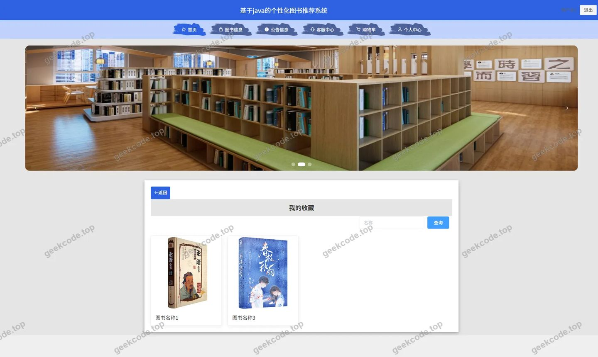</a>

<h4>前台-图书分类列表</h4>

<a href="https://geekcode.top/archives/%E5%9F%BA%E4%BA%8Ejava%E7%9A%84%E4%B8%AA%E6%80%A7%E5%8C%96%E5%9B%BE%E4%B9%A6%E6%8E%A8%E8%8D%90%E7%B3%BB%E7%BB%9F1k4p4?utm_source=github" title="查看完整源码">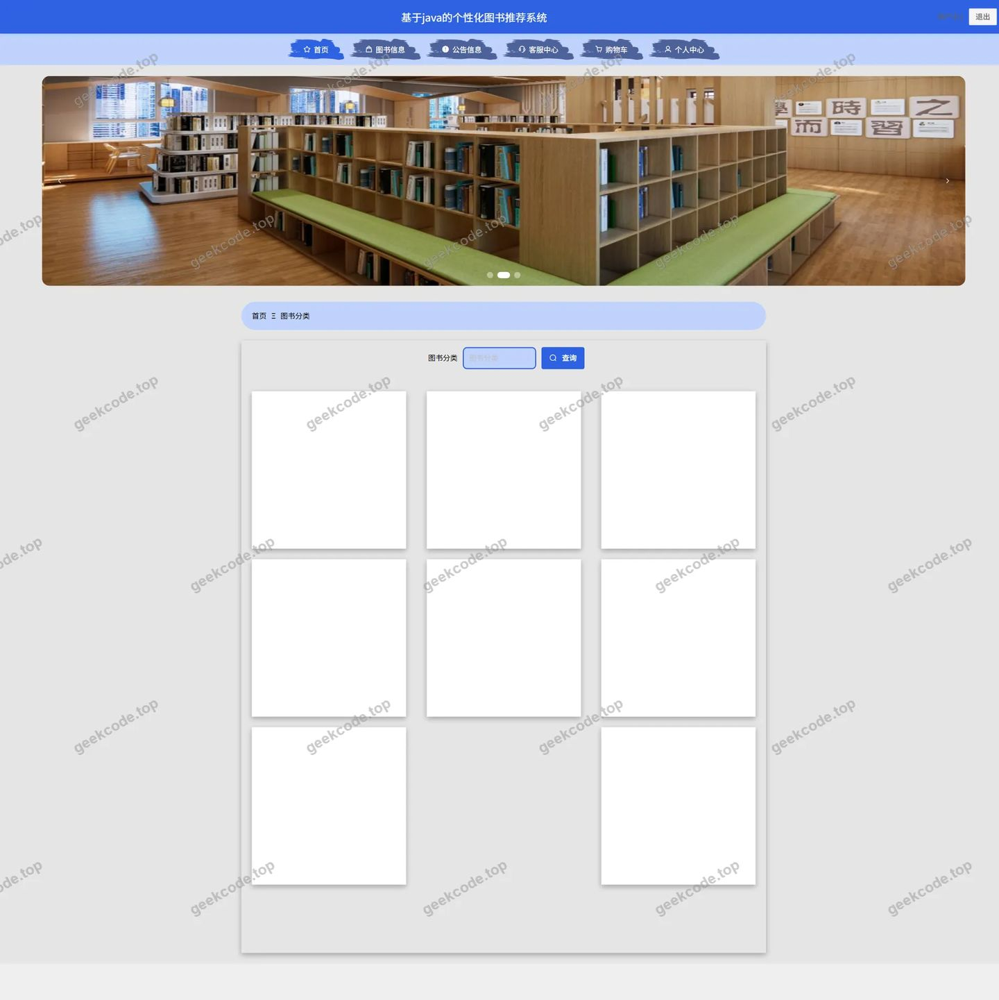</a>

<h4>前台-图书信息列表</h4>

<a href="https://geekcode.top/archives/%E5%9F%BA%E4%BA%8Ejava%E7%9A%84%E4%B8%AA%E6%80%A7%E5%8C%96%E5%9B%BE%E4%B9%A6%E6%8E%A8%E8%8D%90%E7%B3%BB%E7%BB%9F1k4p4?utm_source=github" title="查看完整源码">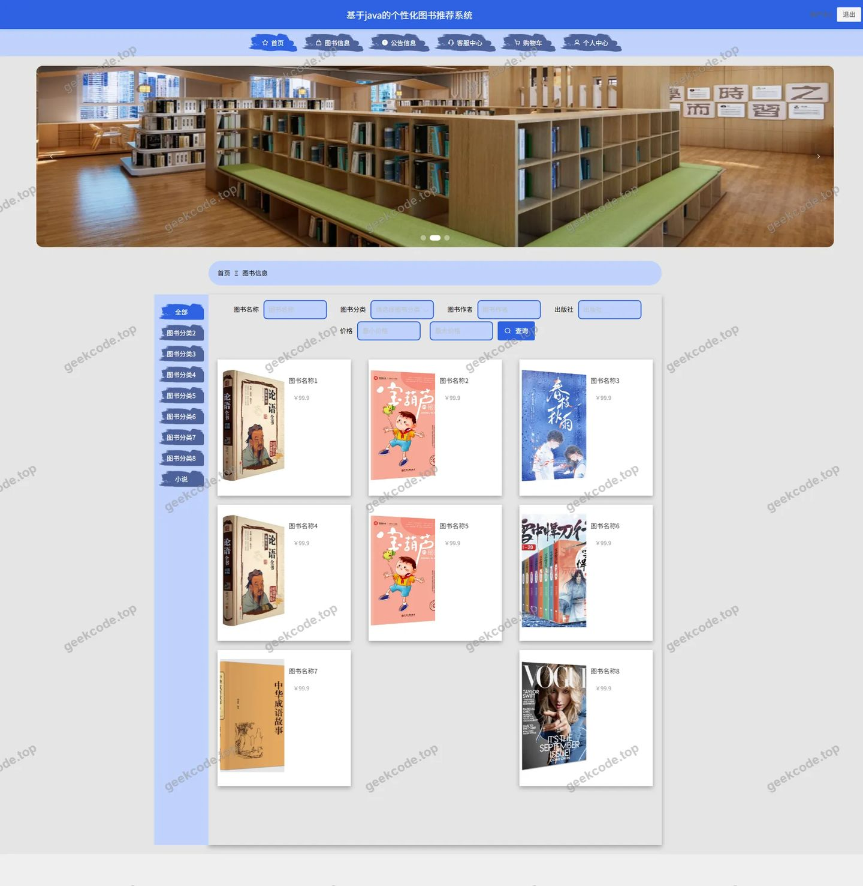</a>

<h4>前台-个人中心</h4>

<a href="https://geekcode.top/archives/%E5%9F%BA%E4%BA%8Ejava%E7%9A%84%E4%B8%AA%E6%80%A7%E5%8C%96%E5%9B%BE%E4%B9%A6%E6%8E%A8%E8%8D%90%E7%B3%BB%E7%BB%9F1k4p4?utm_source=github" title="查看完整源码">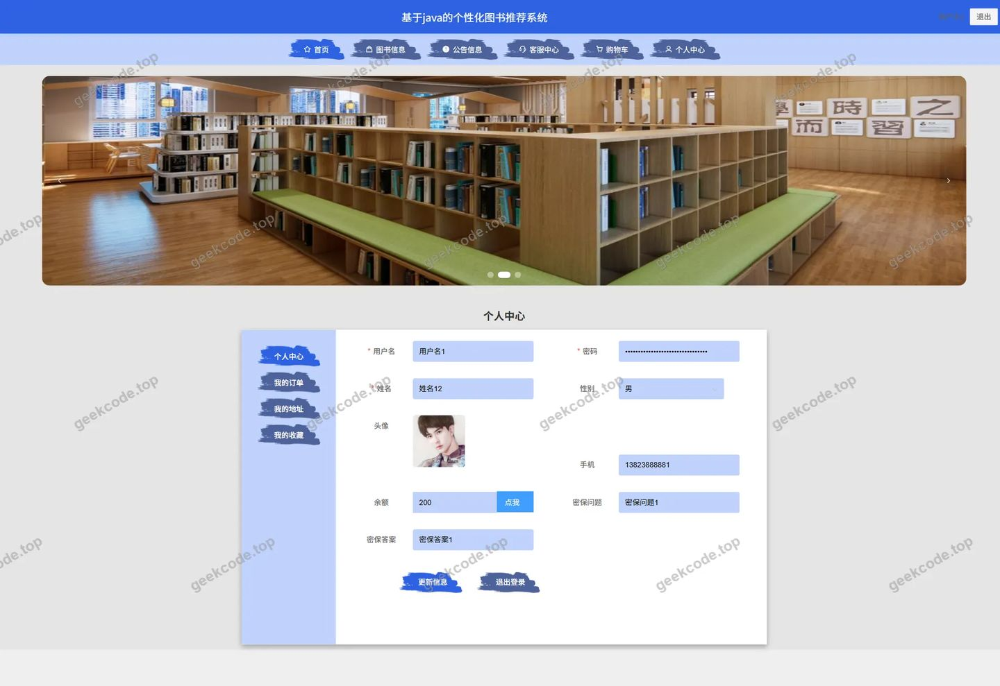</a>

<h4>前台-公告列表</h4>

<h3>后台管理端</h3>
<h4>后台-在线客服</h4>

<h4>后台-系统配置</h4>

<a href="https://geekcode.top/archives/%E5%9F%BA%E4%BA%8Ejava%E7%9A%84%E4%B8%AA%E6%80%A7%E5%8C%96%E5%9B%BE%E4%B9%A6%E6%8E%A8%E8%8D%90%E7%B3%BB%E7%BB%9F1k4p4?utm_source=github" title="查看完整源码">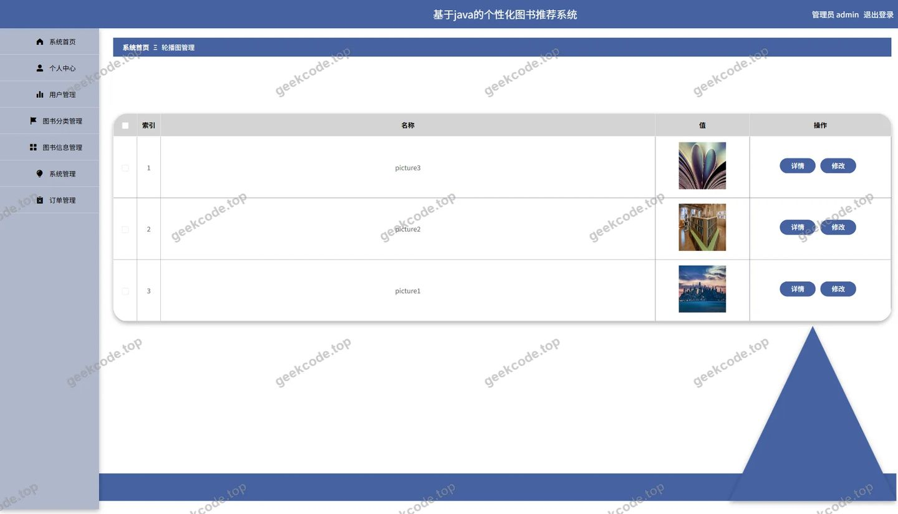</a>

<h4>后台-图书信息评论</h4>

<a href="https://geekcode.top/archives/%E5%9F%BA%E4%BA%8Ejava%E7%9A%84%E4%B8%AA%E6%80%A7%E5%8C%96%E5%9B%BE%E4%B9%A6%E6%8E%A8%E8%8D%90%E7%B3%BB%E7%BB%9F1k4p4?utm_source=github" title="查看完整源码">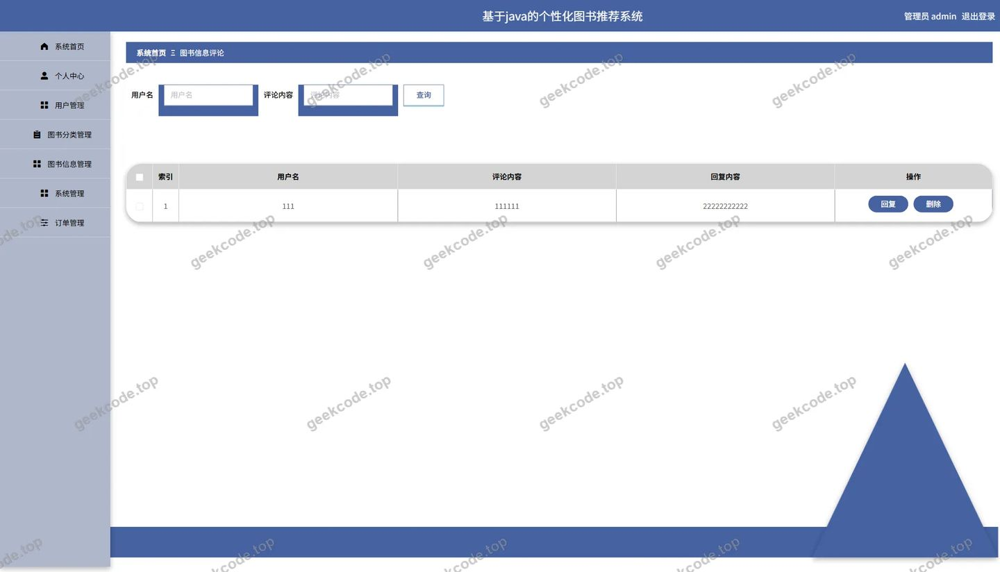</a>

<h4>后台首页</h4>

<a href="https://geekcode.top/archives/%E5%9F%BA%E4%BA%8Ejava%E7%9A%84%E4%B8%AA%E6%80%A7%E5%8C%96%E5%9B%BE%E4%B9%A6%E6%8E%A8%E8%8D%90%E7%B3%BB%E7%BB%9F1k4p4?utm_source=github" title="查看完整源码">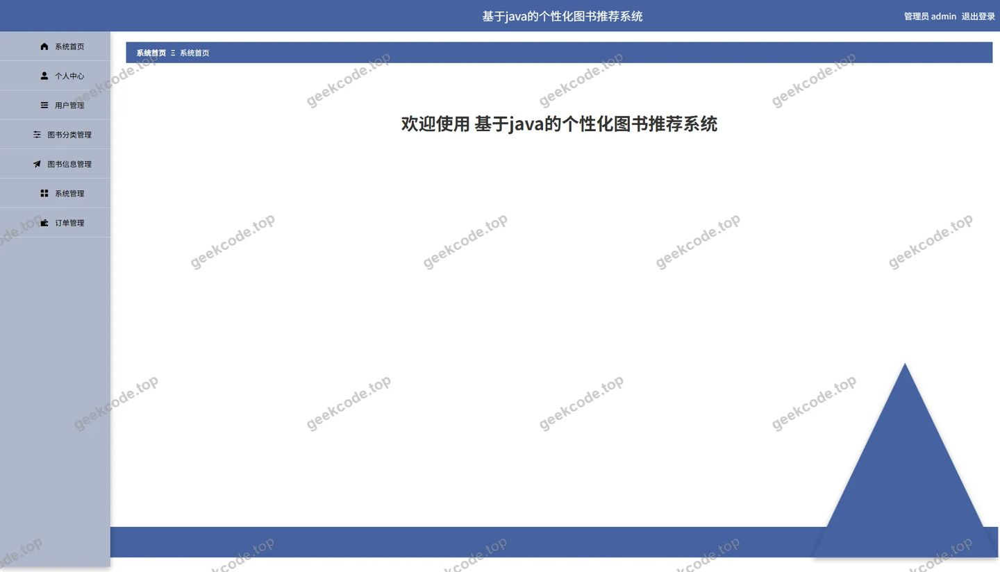</a>

<h4>后台-登录</h4>

<h4>后台-公告信息</h4>

<a href="https://geekcode.top/archives/%E5%9F%BA%E4%BA%8Ejava%E7%9A%84%E4%B8%AA%E6%80%A7%E5%8C%96%E5%9B%BE%E4%B9%A6%E6%8E%A8%E8%8D%90%E7%B3%BB%E7%BB%9F1k4p4?utm_source=github" title="查看完整源码">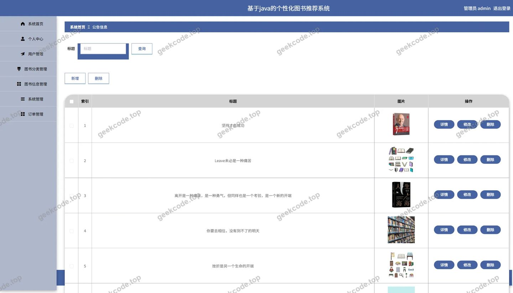</a>

<h4>后台-订单-状态</h4>

<a href="https://geekcode.top/archives/%E5%9F%BA%E4%BA%8Ejava%E7%9A%84%E4%B8%AA%E6%80%A7%E5%8C%96%E5%9B%BE%E4%B9%A6%E6%8E%A8%E8%8D%90%E7%B3%BB%E7%BB%9F1k4p4?utm_source=github" title="查看完整源码">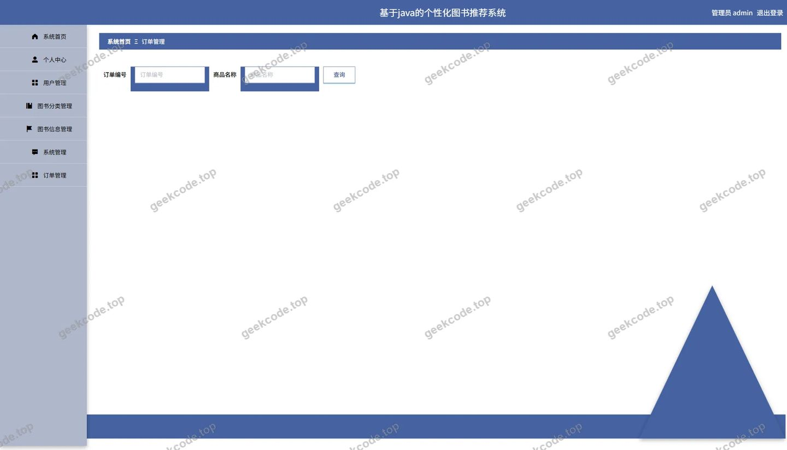</a>

<h4>后台-图书分类</h4>

<a href="https://geekcode.top/archives/%E5%9F%BA%E4%BA%8Ejava%E7%9A%84%E4%B8%AA%E6%80%A7%E5%8C%96%E5%9B%BE%E4%B9%A6%E6%8E%A8%E8%8D%90%E7%B3%BB%E7%BB%9F1k4p4?utm_source=github" title="查看完整源码">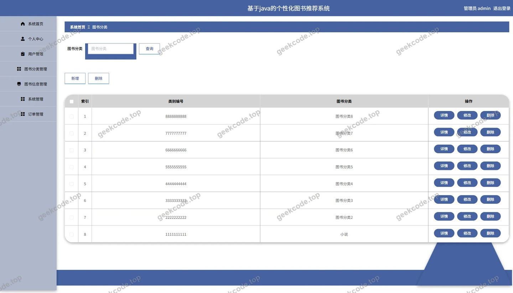</a>

<h4>后台-图书信息</h4>

<a href="https://geekcode.top/archives/%E5%9F%BA%E4%BA%8Ejava%E7%9A%84%E4%B8%AA%E6%80%A7%E5%8C%96%E5%9B%BE%E4%B9%A6%E6%8E%A8%E8%8D%90%E7%B3%BB%E7%BB%9F1k4p4?utm_source=github" title="查看完整源码">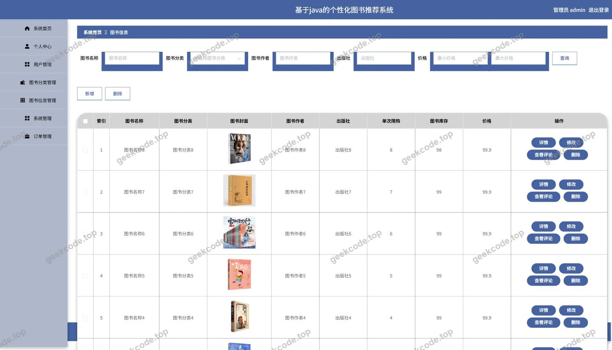</a>

---

## 获取完整源码

| 项目 | 说明 |
| --- | --- |
| 项目名 | 基于java的个性化图书推荐系统1k4p4 |
| 运行截图 | 本文 14 张（站点带水印原图，仓库 `images/` 目录） |
| 完整源码 | [https://geekcode.top/archives/%E5%9F%BA%E4%BA%8Ejava%E7%9A%84%E4%B8%AA%E6%80%A7%E5%8C%96%E5%9B%BE%E4%B9%A6%E6%8E%A8%E8%8D%90%E7%B3%BB%E7%BB%9F1k4p4?utm_source=github](https://geekcode.top/archives/%E5%9F%BA%E4%BA%8Ejava%E7%9A%84%E4%B8%AA%E6%80%A7%E5%8C%96%E5%9B%BE%E4%B9%A6%E6%8E%A8%E8%8D%90%E7%B3%BB%E7%BB%9F1k4p4?utm_source=github) |
| 咨询微信 | **ir9372**（备注：jingpin-yuanma） |
| 更多项目 | [极客代码 geekcode.top](https://geekcode.top/?utm_source=github) |

> 需要源码、部署、改配置、跑不起来等问题，加微信 ir9372 沟通，说明项目名即可。
